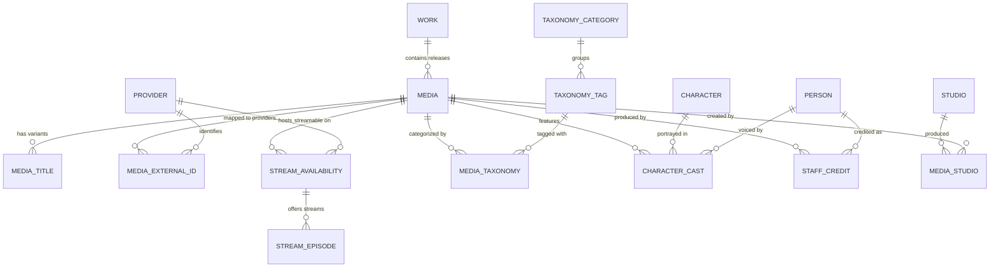

# Anime-Dimension V3 Database Schema Architecture

## 1. Executive Summary & Problem Statement

### 1.1 The Legacy V2 Schema Constraints
Anime-Dimension's V2 database architecture was evolved iteratively:
1. **AniList Hegemony**: The base `anime` table directly models AniList media entries. Other providers (Crunchyroll, HiDive, Anime-Planet) were attached via separate tables (`CrShows`, `HdShows`, `ApShows`) or mapping tables (`CrAnMap`, `HdAnMap`, `ApAnMap`).
2. **Entity Fragmentation**:
   - Franchises vs. Releases are split between `anime`, `Series`, and `SeriesSeason`.
   - External IDs are split between numeric IDs (`external_id`), string IDs (`external_id_text`), series-level numeric IDs (`SeriesExternalId`), and series-level text IDs (`SeriesExternalIdText`).
3. **Provider Sprawl**: Adding any new provider (e.g. Netflix, Disney+, Hulu, MyAnimeList) requires bespoke schema alterations (`NfShows`, `NfAnMap`, etc.).
4. **Taxonomy Rigidity**: Tags are flat text entries without hierarchy (genres, themes, demographics, content warnings are mixed together).

### 1.2 The V3 Vision
The **V3 Unified Anime Schema** re-architects the database into a **source-neutral, multi-provider anime catalog** with:
- **Clean Franchise / Work / Release hierarchy**.
- **Universal Provider Model**: Providers are first-class pluggable entities.
- **Unified Streaming Availability**: A single, normalized streaming source layer across all platforms.
- **Relational Cast & Staff**: Proper people, characters, and voice actor credits.
- **Zero-Downtime View-Based Backwards Compatibility**: Migration views that emulate V2 tables so the existing website frontend and backend APIs can run unmodified until gradual adoption.

---

## 2. Entity Relationship Overview



---

## 3. Detailed Schema Specification

### 3.1 Core Catalog Entities

#### `works` (High-level intellectual property / franchise)
```sql
CREATE TABLE works (
    id INTEGER PRIMARY KEY AUTOINCREMENT,
    slug TEXT NOT NULL UNIQUE,
    canonical_title TEXT NOT NULL,
    synopsis TEXT NULL,
    original_format TEXT NULL, -- Manga, Light Novel, Original, Game, Visual Novel
    created_at TEXT NOT NULL DEFAULT (CURRENT_TIMESTAMP),
    updated_at TEXT NOT NULL DEFAULT (CURRENT_TIMESTAMP)
);
CREATE INDEX idx_works_slug ON works(slug);
```

#### `media` (Concrete release unit: TV Season, Movie, OVA, Special)
```sql
CREATE TABLE media (
    id INTEGER PRIMARY KEY AUTOINCREMENT,
    work_id INTEGER NULL,
    slug TEXT NOT NULL UNIQUE,
    canonical_title TEXT NOT NULL,
    format TEXT NOT NULL, -- TV, Movie, OVA, ONA, Special, MusicVideo
    status TEXT NOT NULL, -- Finished, Releasing, Upcoming, Cancelled
    episodes INTEGER NULL,
    duration_minutes INTEGER NULL,
    release_year INTEGER NULL,
    release_season TEXT NULL, -- Winter, Spring, Summer, Fall
    start_date TEXT NULL, -- ISO-8601 (YYYY-MM-DD)
    end_date TEXT NULL,
    synopsis TEXT NULL,
    cover_image_url TEXT NULL,
    banner_image_url TEXT NULL,
    country_of_origin TEXT NOT NULL DEFAULT 'JP', -- ISO-3166-1 alpha-2
    is_adult INTEGER NOT NULL DEFAULT 0,
    created_at TEXT NOT NULL DEFAULT (CURRENT_TIMESTAMP),
    updated_at TEXT NOT NULL DEFAULT (CURRENT_TIMESTAMP),
    FOREIGN KEY (work_id) REFERENCES works(id) ON DELETE SET NULL
);
CREATE INDEX idx_media_slug ON media(slug);
CREATE INDEX idx_media_work ON media(work_id);
CREATE INDEX idx_media_year_season ON media(release_year, release_season);
CREATE INDEX idx_media_format ON media(format);
```

#### `media_titles` (Multi-lingual & synonym titles)
```sql
CREATE TABLE media_titles (
    id INTEGER PRIMARY KEY AUTOINCREMENT,
    media_id INTEGER NOT NULL,
    title TEXT NOT NULL,
    language_code TEXT NOT NULL DEFAULT 'en', -- en, ja, ja-Latn (Romaji), zh, ko, de, fr, es
    kind TEXT NOT NULL, -- canonical, official, romaji, native, synonym, abbreviation, typo
    is_primary INTEGER NOT NULL DEFAULT 0,
    FOREIGN KEY (media_id) REFERENCES media(id) ON DELETE CASCADE
);
CREATE INDEX idx_media_titles_title ON media_titles(title COLLATE NOCASE);
CREATE INDEX idx_media_titles_media ON media_titles(media_id);
```

---

### 3.2 Providers & External Cross-References

#### `providers` (External databases and streaming services)
```sql
CREATE TABLE providers (
    id INTEGER PRIMARY KEY AUTOINCREMENT,
    code TEXT NOT NULL UNIQUE, -- anilist, anime-planet, crunchyroll, hidive, mal, tmdb
    name TEXT NOT NULL,
    provider_type TEXT NOT NULL, -- metadata, streaming, shop
    base_url TEXT NULL,
    icon_svg TEXT NULL,
    priority INTEGER NOT NULL DEFAULT 100
);
```

#### `media_external_ids` (Unified cross-identifier table)
Eliminates the previous numeric/text split by storing external IDs as text with an optional parsed integer.
```sql
CREATE TABLE media_external_ids (
    id INTEGER PRIMARY KEY AUTOINCREMENT,
    media_id INTEGER NOT NULL,
    provider_id INTEGER NOT NULL,
    external_id TEXT NOT NULL,
    external_numeric_id INTEGER NULL,
    external_url TEXT NULL,
    match_confidence REAL NOT NULL DEFAULT 1.0, -- 1.0 = exact verified, 0.8 = heuristic match
    last_verified_at TEXT NOT NULL DEFAULT (CURRENT_TIMESTAMP),
    FOREIGN KEY (media_id) REFERENCES media(id) ON DELETE CASCADE,
    FOREIGN KEY (provider_id) REFERENCES providers(id) ON DELETE CASCADE,
    UNIQUE (provider_id, external_id)
);
CREATE INDEX idx_ext_media ON media_external_ids(media_id);
CREATE INDEX idx_ext_provider_num ON media_external_ids(provider_id, external_numeric_id);
```

---

### 3.3 Streaming Availability & Releases

#### `stream_availabilities` (Unified multi-platform streaming status)
```sql
CREATE TABLE stream_availabilities (
    id INTEGER PRIMARY KEY AUTOINCREMENT,
    media_id INTEGER NOT NULL,
    provider_id INTEGER NOT NULL,
    region TEXT NOT NULL DEFAULT 'GLOBAL', -- AU, US, UK, CA, GLOBAL
    access_type TEXT NOT NULL DEFAULT 'subscription', -- free, subscription, purchase, rental
    watch_url TEXT NOT NULL,
    is_subbed INTEGER NOT NULL DEFAULT 1,
    is_dubbed INTEGER NOT NULL DEFAULT 0,
    audio_locales_json TEXT NULL, -- ["ja-JP", "en-US"]
    subtitle_locales_json TEXT NULL, -- ["en-US", "es-419"]
    quality_max TEXT NULL, -- 1080p, 4k
    is_simulcast INTEGER NOT NULL DEFAULT 0,
    updated_at TEXT NOT NULL DEFAULT (CURRENT_TIMESTAMP),
    FOREIGN KEY (media_id) REFERENCES media(id) ON DELETE CASCADE,
    FOREIGN KEY (provider_id) REFERENCES providers(id) ON DELETE CASCADE,
    UNIQUE (media_id, provider_id, region)
);
CREATE INDEX idx_stream_media ON stream_availabilities(media_id);
CREATE INDEX idx_stream_provider_region ON stream_availabilities(provider_id, region);
```

#### `stream_episodes` (Direct episode player links)
```sql
CREATE TABLE stream_episodes (
    id INTEGER PRIMARY KEY AUTOINCREMENT,
    media_id INTEGER NOT NULL,
    provider_id INTEGER NOT NULL,
    episode_number REAL NOT NULL, -- Supports 0.5 specials, 1, 2, etc.
    title TEXT NULL,
    stream_url TEXT NOT NULL,
    thumbnail_url TEXT NULL,
    duration_seconds INTEGER NULL,
    is_dub INTEGER NOT NULL DEFAULT 0,
    is_premium_only INTEGER NOT NULL DEFAULT 0,
    release_date_utc TEXT NULL,
    FOREIGN KEY (media_id) REFERENCES media(id) ON DELETE CASCADE,
    FOREIGN KEY (provider_id) REFERENCES providers(id) ON DELETE CASCADE
);
CREATE INDEX idx_stream_ep_media_num ON stream_episodes(media_id, episode_number);
```

---

### 3.4 Taxonomy, Cast & Credits

#### `taxonomies` & `media_taxonomies`
```sql
CREATE TABLE taxonomy_categories (
    id INTEGER PRIMARY KEY AUTOINCREMENT,
    name TEXT NOT NULL UNIQUE -- Genre, Theme, Demographic, Content Warning
);

CREATE TABLE taxonomies (
    id INTEGER PRIMARY KEY AUTOINCREMENT,
    category_id INTEGER NOT NULL,
    slug TEXT NOT NULL UNIQUE,
    name TEXT NOT NULL,
    description TEXT NULL,
    FOREIGN KEY (category_id) REFERENCES taxonomy_categories(id)
);

CREATE TABLE media_taxonomies (
    media_id INTEGER NOT NULL,
    taxonomy_id INTEGER NOT NULL,
    weight REAL NOT NULL DEFAULT 1.0, -- Relevance score (e.g., 0.0 - 1.0)
    PRIMARY KEY (media_id, taxonomy_id),
    FOREIGN KEY (media_id) REFERENCES media(id) ON DELETE CASCADE,
    FOREIGN KEY (taxonomy_id) REFERENCES taxonomies(id) ON DELETE CASCADE
);
```

#### People, Characters, and Credits
```sql
CREATE TABLE people (
    id INTEGER PRIMARY KEY AUTOINCREMENT,
    canonical_name TEXT NOT NULL,
    native_name TEXT NULL,
    image_url TEXT NULL
);

CREATE TABLE characters (
    id INTEGER PRIMARY KEY AUTOINCREMENT,
    canonical_name TEXT NOT NULL,
    native_name TEXT NULL,
    image_url TEXT NULL,
    description TEXT NULL
);

CREATE TABLE character_cast (
    id INTEGER PRIMARY KEY AUTOINCREMENT,
    media_id INTEGER NOT NULL,
    character_id INTEGER NOT NULL,
    person_id INTEGER NULL, -- Voice actor
    role_type TEXT NOT NULL DEFAULT 'main', -- main, supporting, background
    language_code TEXT NOT NULL DEFAULT 'ja',
    FOREIGN KEY (media_id) REFERENCES media(id) ON DELETE CASCADE,
    FOREIGN KEY (character_id) REFERENCES characters(id) ON DELETE CASCADE,
    FOREIGN KEY (person_id) REFERENCES people(id) ON DELETE SET NULL
);
```

---

## 4. Backwards-Compatibility Layer (V2 Emulation Views)

During migration, the database provides SQL views matching the exact column definitions of V2. Existing Astro page queries and C# API endpoints continue functioning with zero code changes:

```sql
-- Emulate legacy `anime` table
CREATE VIEW anime AS
SELECT
    m.id,
    m.slug,
    m.canonical_title AS title,
    (SELECT GROUP_CONCAT(t.title, ' | ') FROM media_titles t WHERE t.media_id = m.id AND t.is_primary = 0) AS alt_title,
    m.cover_image_url AS thumbnail_url,
    m.cover_image_url AS thumbnail_source_url,
    m.synopsis,
    CAST(m.release_year AS TEXT) AS year,
    m.release_season AS season,
    m.format AS type,
    m.episodes AS data_total_episodes,
    m.created_at,
    m.updated_at
FROM media m;

-- Emulate legacy `source_system`
CREATE VIEW source_system AS
SELECT id, name, code, base_url AS homepage FROM providers;

-- Emulate legacy `external_id`
CREATE VIEW external_id AS
SELECT
    id,
    media_id AS anime_id,
    provider_id AS source_id,
    external_numeric_id,
    external_url
FROM media_external_ids
WHERE external_numeric_id IS NOT NULL;

-- Emulate legacy `ApAnMap`
CREATE VIEW ApAnMap AS
SELECT
    'ap:' || e.external_id AS Id,
    e.external_numeric_id AS ApId,
    t.title AS ApTitle,
    m.slug AS ApSlug,
    m.id AS AnId
FROM media_external_ids e
JOIN media m ON m.id = e.media_id
JOIN media_titles t ON t.media_id = m.id
WHERE e.provider_id = (SELECT id FROM providers WHERE code = 'anime-planet');
```

---

## 5. Phased Migration Roadmap

| Phase | Description | Status |
| :--- | :--- | :---: |
| **Phase 1** | **V2 Extended Schema (Active)**: Extends current schema with `ApShows`, `ApAnMap`, streaming tables, and multi-provider external IDs. Production-ready and in use. | ✅ Complete |
| **Phase 2** | **Orchestrator V3 Generator**: Introduce `--AD-DB-V3` task in `Database-Orchestrator` to produce the clean V3 schema side-by-side with V2 compatibility views. | 📋 Planned |
| **Phase 3** | **API Migration**: Update `Anime-Dimension-api` endpoints to query the native `media`, `stream_availabilities`, and `works` tables for richer features. | 📋 Planned |
| **Phase 4** | **Frontend Modernization**: Leverage the new `works` franchise hierarchy on the Astro frontend for clean multi-season navigators, streaming provider badges, and character cast carousels. | 📋 Planned |
| **Phase 5** | **Deprecate V2 Views**: Remove legacy emulation views once all frontend components and background jobs use V3 tables directly. | 📋 Planned |
